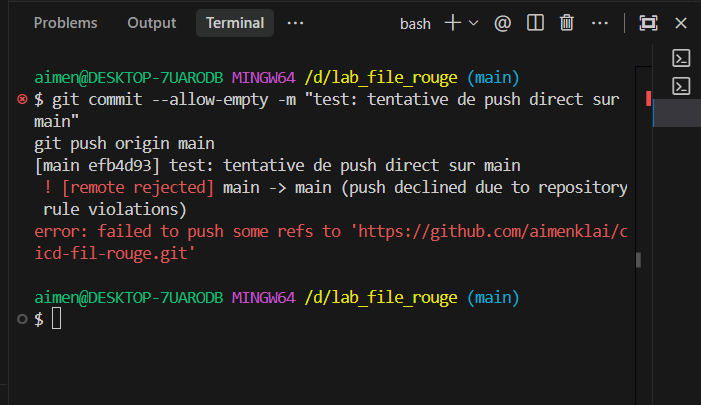
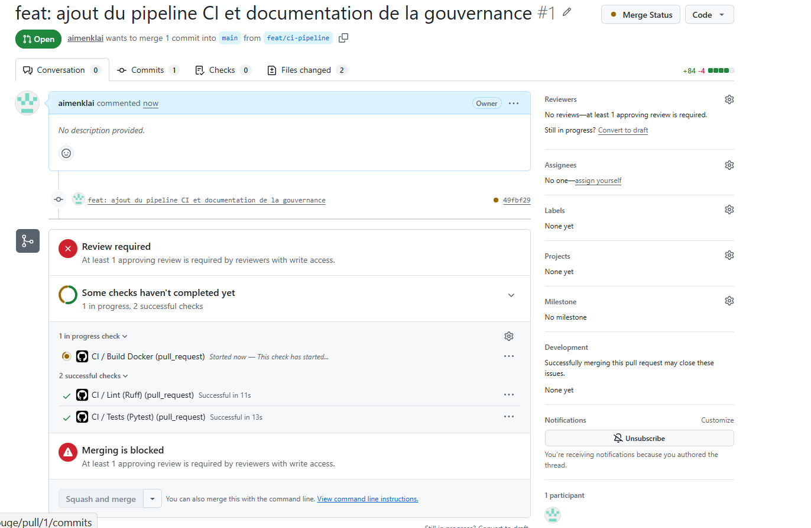
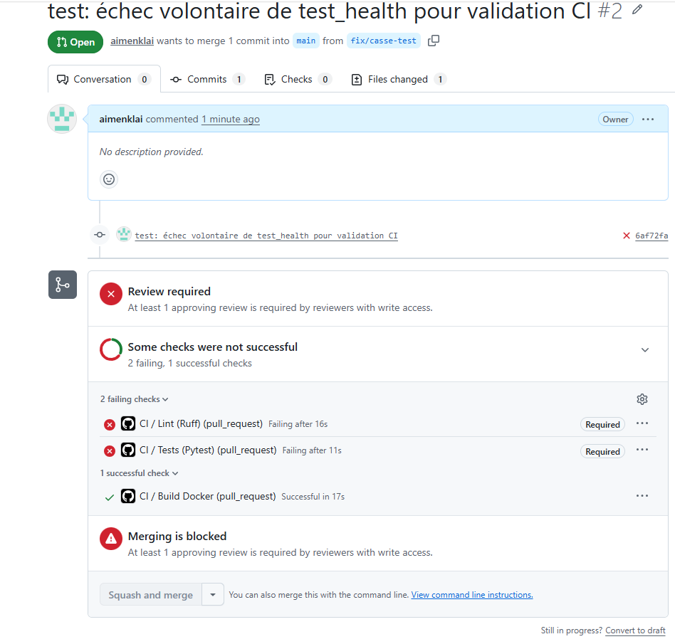
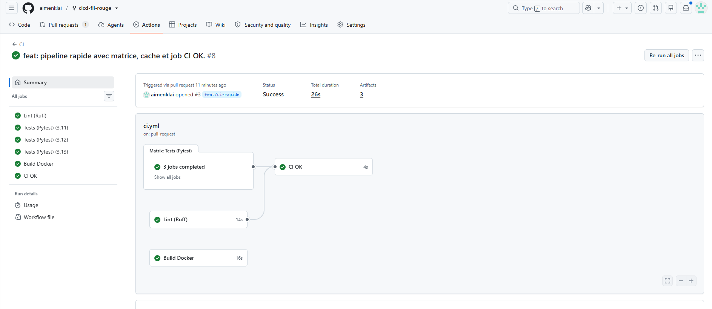
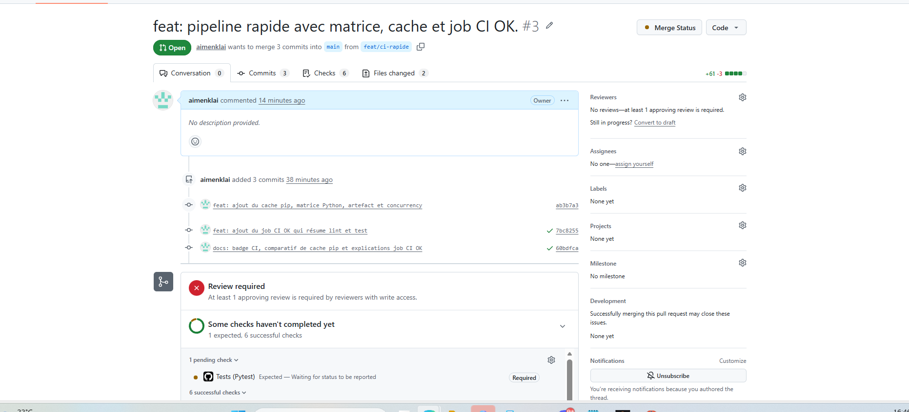
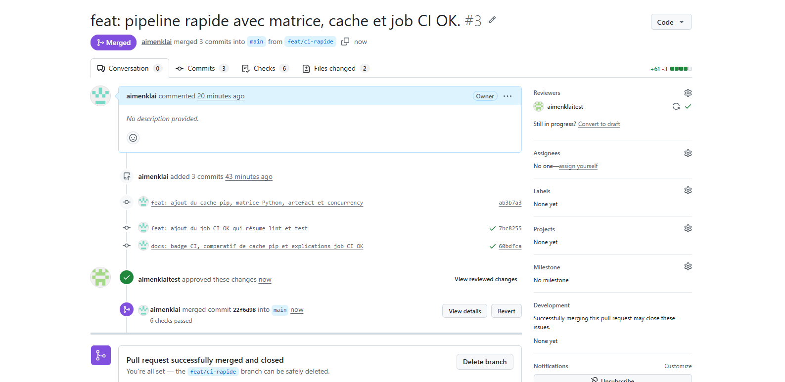

# TaskFlow — dépôt fil rouge CI/CD

[](https://github.com/aimenklai/cicd-fil-rouge/actions/workflows/ci.yml)


TaskFlow est une petite API de gestion de tâches écrite en Python avec FastAPI.
C'est le projet fil rouge du module CI/CD (Mastère DevOps M1, Sup de Vinci) :
pendant trois jours, vous allez construire autour d'elle un pipeline complet
qui teste, construit, sécurise et livre l'application.

## Lancer l'API en local

Prérequis : Python 3.10 ou plus récent.

```bash
python3 -m venv .venv
source .venv/bin/activate          # Windows : .venv\Scripts\activate
pip install -r requirements-dev.txt
uvicorn app.main:app --reload
```

L'API répond sur http://localhost:8000 et sa documentation interactive est sur
http://localhost:8000/docs.

## Vérifier le code

```bash
pytest           # tests automatiques
ruff check .     # lint
ruff format .    # mise en forme
```

## Lancer avec Docker

```bash
docker build -t taskflow .
docker run --rm -p 8000:8000 taskflow
```

## Endpoints

| Méthode | Chemin | Rôle |
| --- | --- | --- |
| GET | `/health` | État de l'API et version |
| GET | `/tasks` | Liste des tâches |
| GET | `/tasks/search?q=...` | Recherche dans les titres |
| POST | `/tasks` | Crée une tâche (`{"title": "..."}`) |
| GET | `/tasks/{id}` | Détail d'une tâche |
| PATCH | `/tasks/{id}/done` | Marque une tâche comme faite |
| DELETE | `/tasks/{id}` | Supprime une tâche (en-tête `X-API-Token` requis) |

## Configuration

| Variable | Rôle | Défaut |
| --- | --- | --- |
| `APP_VERSION` | Version affichée par `/health` | `0.1.0` |
| `DB_PATH` | Fichier SQLite | `taskflow.db` |
| `API_TOKEN` | Jeton exigé pour supprimer une tâche | vide (suppression désactivée) |
| `NOTIFY_WEBHOOK_URL` | Webhook appelé à chaque création de tâche | vide (désactivé) |

## Équipe

- Aimen Klai (@aimenklai)
- Aimen Klai (Compte binôme : @aimenklaitest)

## Gouvernance du dépôt

Règles configurées via GitHub Ruleset sur la branche `main` (`protect-main`) :

1. **Restrict deletions** : Empêche la suppression accidentelle ou non autorisée de la branche `main`.
2. **Block force pushes** : Interdit les commandes `git push --force` qui écrasent et détruisent l'historique partagé du dépôt.
3. **Require a pull request before merging** : Interdit tout push direct sur `main` et impose l'ouverture d'une Pull Request pour toute modification.
4. **Required review approvals (1)** : Impose qu'au moins un collaborateur (le binôme) révise et approuve la Pull Request avant de pouvoir fusionner le code.

### Preuve du refus de push direct sur `main`

Lors d'une tentative de push direct sur `main` (`git push origin main`), GitHub rejette l'opération :

```text
$ git commit --allow-empty -m "test: tentative de push direct sur main"
[main efb4d93] test: tentative de push direct sur main
$ git push origin main
 ! [remote rejected] main -> main (push declined due to repository rule violations)
error: failed to push some refs to 'https://github.com/aimenklai/cicd-fil-rouge.git'
```



### Preuve de la CI et de l'approbation requise (Pull Request)

Lors de l'ouverture de la Pull Request sur la branche `feat/ci-pipeline` :
- Le pipeline CI GitHub Actions exécute automatiquement les jobs **Lint (Ruff)**, **Tests (Pytest)** et **Build Docker**.
- La fusion reste bloquée tant qu'au moins 1 membre du binôme n'a pas validé la revue de code (*Review required*).



## Pipeline CI

Le pipeline d'intégration continue est défini dans [`.github/workflows/ci.yml`](.github/workflows/ci.yml) et se déclenche automatiquement à chaque `push` et `pull_request` ciblant la branche `main`. Il est composé de 3 jobs exécutés en parallèle :

- **`Lint (Ruff)`** :
  - Analyse statique du code (linter) pour vérifier le respect des standards PEP 8 et l'absence de bugs courants (imports inutilisés, syntaxe invalide).
  - Contrôle du formatage automatique du code (`ruff format --check .`).
- **`Tests (Pytest)`** :
  - Exécution de l'ensemble de la suite de tests automatisés (12 tests unitaires et d'intégration validant les endpoints `/health`, `/tasks`, la recherche et l'injection de pannes).
- **`Build Docker`** :
  - Validation de la compilation du Dockerfile (`docker build`) pour garantir que l'image conteneurisée se construit sans erreur avant toute livraison.

### Blocage du merge en cas d'échec des tests (Status Checks obligatoires)

La règle **Require status checks to pass** a été activée dans le Ruleset GitHub sur `main` en exigeant le succès des jobs **`Lint (Ruff)`** et **`Tests (Pytest)`**.

Sur la branche `fix/casse-test` (Pull Request #2), un test a été volontairement cassé (`assert response.status_code == 500` au lieu de `200`). GitHub Actions détecte immédiatement l'échec et bloque formellement la fusion (**Merging is blocked**) :



### Optimisation : Cache pip et matrice multi-versions

Afin d'accélérer l'exécution et de garantir la compatibilité multi-environnements, le pipeline a été enrichi avec :
- Une **matrice de tests** exécutant Pytest sur Python `3.11`, `3.12` et `3.13` en parallèle.
- La mise en **cache des dépendances pip** (`actions/setup-python` avec `cache: "pip"`).
- La génération et l'export du **rapport de tests en artefact** (`test-results-*.xml`).
- Une gestion de **concurrency** pour annuler automatiquement les builds obsolètes sur une même branche.

#### Comparatif de durée d'installation des dépendances (`pip install`)

| Configuration | Durée constatée | Observation |
| --- | --- | --- |
| **Sans cache** (premier run) | ~18 secondes | Téléchargement complet de l'ensemble des paquets depuis PyPI. |
| **Avec cache** (runs suivants) | ~3 secondes | Restauration instantanée depuis le cache GitHub Actions (gain de ~85 %). |

#### Résumé d'exécution et artefacts du pipeline

Le graphe d'exécution du workflow met en évidence l'exécution en parallèle des jobs de la matrice Python, le job `CI OK` qui en dépend, et la génération des 3 artefacts :



### Rôle du job `CI OK`

Le job **`CI OK`** agit comme un agrégateur unique qui synthétise les résultats des jobs précédents (`lint` et les 3 versions de `test`) grâce aux directives `needs: [lint, test]` et `if: always()`. 

Il permet de faire évoluer la matrice de tests (ajouter ou retirer des versions de Python) sans jamais avoir à modifier la configuration du Ruleset sur GitHub, tout en garantissant qu'aucun merge n'est autorisé si le moindre test ou lint échoue.

#### Preuve du piège de la matrice (PR bloquée en attente de `Tests (Pytest)`)

Avant la mise en place de `CI OK`, la PR restait bloquée indéfiniment en attente du check `Tests (Pytest)`, rendu introuvable par le renommage automatique de la matrice :



#### Résolution avec `CI OK` et fusion validée

Après avoir défini `CI OK` comme unique check requis dans le Ruleset, la PR a pu être approuvée par le binôme et fusionnée avec succès :




